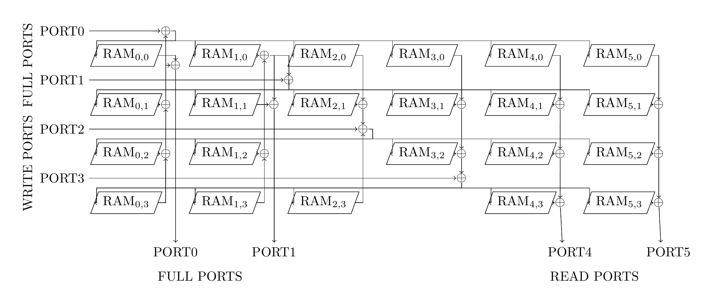

# mpm

[](https://github.com/kevintownsend/mpm/actions/workflows/ci.yml)

Parameterized multi-port memory architectures in SystemVerilog using bidirectional XOR banks and Live Value Tables (LVT), targeting FPGA block RAM (BRAM) and distributed LUT RAM primitives.

## FPGA '26 Publication & Synthesis Highlights

This repository accompanies the ACM/SIGDA FPGA '26 paper:

> **Multi-Port Memory with Bidirectional Ports for FPGAs Using XOR and LVT Methods**  
> Kevin Townsend — *Proceedings of the 2026 ACM/SIGDA International Symposium on Field Programmable Gate Arrays (FPGA '26)*  
> DOI: [10.1145/3748173.3779548](https://doi.org/10.1145/3748173.3779548) · [Short Paper (PDF)](doc/fpga26/paper.pdf) · [Poster (PDF)](doc/fpga26/poster/poster.pdf) · [Full Manuscript (PDF)](doc/paper.pdf)

- **Key Idea**: Generalizes XOR multi-port memory ($a \oplus b \oplus b = a$) to support bidirectional (read/write) ports using $F^2$ simple dual-port RAMs, and uses bidirectional XOR memory as the Live Value Table (LVT) index to scale wide multi-port memories with $F(F - 1)/2$ data BRAMs.



*Generalized XOR memory architecture (`2` full, `2` write-only, and `2` read-only ports using `22` RAMs). The repository provides symmetric bidirectional modules (`FULL PORTS = PORTS`, using `PORTS²` RAMs for XOR and `PORTS*(PORTS-1)/2` data BRAMs for LVT) alongside the generalized asymmetric [`xor_asymmetric_memory`](rtl/xor_asymmetric_memory.sv) module supporting arbitrary `(FULL_PORTS, WRITE_PORTS, READ_PORTS)` configurations.*

- **Vivado Synthesis Summary** (`WIDTH = 32`, `DEPTH = 1024`, targeting an AMD Virtex UltraScale+ HBM VU47P-3; 16- and 32-port designs wrapped with serialized I/O in [`syn/`](syn/)):

| Ports | XOR BRAM (`Fmax` / BRAMs / LUTs) | LVT (`Fmax` / BRAMs / LUTs) | LVT Pipelined (`Fmax` / BRAMs / LUTs) |
| --- | --- | --- | --- |
| 2 | 625 MHz / 4 / 144 | 588 MHz / 1 / 191 | 714 MHz / 1 / 119 |
| 4 | 476 MHz / 16 / 512 | 556 MHz / 6 / 1,144 | 667 MHz / 6 / 1,268 |
| 8 | 370 MHz / 64 / 1,920 | 455 MHz / 28 / 5,428 | 625 MHz / 28 / 5,588 |
| 16 | 263 MHz / 256 / 6,656 | 250 MHz / 120 / 31,075 | 417 MHz / 120 / 31,328 |
| 32 | 123 MHz / 1,024 / 10,240 | 127 MHz / 496 / 161,216 | 247 MHz / 496 / 162,960 |

## Modules

All multi-port top-level modules share the uniform port interface:

- `clk`: Clock input
- `addr[PORTS-1:0]`: Per-port read/write address (`$clog2(DEPTH)` bits)
- `d[PORTS-1:0]`: Per-port write data (`WIDTH` bits)
- `en[PORTS-1:0]`: Per-port write enable
- `q[PORTS-1:0]`: Per-port read data (`WIDTH` bits)

All top-level modules are parameterized by `WIDTH`, `DEPTH`, and `PORTS` (`PORTS >= 2`).

| Module | Backing Storage | Read Latency | Notes |
| --- | --- | --- | --- |
| [`xor_memory`](rtl/xor_memory.sv) | `simple_dual_port_memory_wrapper` (`USE_XPM=0`) or `simple_dual_port_memory_xilinx` (`USE_XPM=1`) | 1 cycle | Buffered write with same-cycle write forwarding |
| [`xor_asymmetric_memory`](rtl/xor_asymmetric_memory.sv) | `simple_dual_port_memory_wrapper` / `simple_dual_port_memory_xilinx` | 1 cycle | Arbitrary `FULL_PORTS`, `WRITE_PORTS`, and `READ_PORTS` (`(W + F)(W + F + R) - W` RAMs) |
| [`xor_bram_memory_pipelined`](rtl/xor_bram_memory_pipelined.sv) | `simple_dual_port_memory_wrapper` / `simple_dual_port_memory_xilinx` | 2 cycles | Registered output stage for BRAM timing closure |
| [`xor_distributed_memory`](rtl/xor_distributed_memory.sv) | `simple_distributed_ram` | 0 cycles (comb.) | Synchronous write, combinational read |
| [`xor_distributed_memory_pipelined`](rtl/xor_distributed_memory_pipelined.sv) | `simple_distributed_ram` | 2 cycles | Pipelined read/write path; avoid adjacent-cycle writes |
| [`lvt_memory`](rtl/lvt_memory.sv) | `dual_port_memory` + `xor_distributed_memory` | 1 cycle | XOR-based LVT index with BRAM bank storage |
| [`lvt_memory_pipelined`](rtl/lvt_memory_pipelined.sv) | `dual_port_memory` + `xor_distributed_memory_pipelined` | 2 cycles | Pipelined LVT + registered bank outputs; avoid adjacent-cycle writes |

### Supporting Primitives & Synthesis Wrappers

- [`rtl/simple_dual_port_memory.sv`](rtl/simple_dual_port_memory.sv): Generic synchronous simple dual-port RAM.
- [`rtl/simple_dual_port_memory_wrapper.sv`](rtl/simple_dual_port_memory_wrapper.sv): Adds read-during-write bypass forwarding around `simple_dual_port_memory`.
- [`rtl/simple_dual_port_memory_xilinx.sv`](rtl/simple_dual_port_memory_xilinx.sv): Xilinx `xpm_memory_sdpram` wrapper selected via `USE_XPM=1` on BRAM XOR modules for Vivado flows.
- [`rtl/simple_distributed_ram.sv`](rtl/simple_distributed_ram.sv): Synchronous write / combinational read distributed RAM primitive.
- [`rtl/dual_port_memory.sv`](rtl/dual_port_memory.sv): True dual-port RAM primitive for LVT data banks.
- [`syn/`](syn/): Scripted non-project Vivado flow ([`syn/synth.tcl`](syn/synth.tcl)), serialized shift-register I/O wrappers (`*_syn.sv`), legacy Vivado project ([`syn/syn.xpr`](syn/syn.xpr)), and synthesis documentation ([`syn/README.md`](syn/README.md)).

## Simulation & Linting

Install Verilator:

```sh
sudo apt install verilator
```

Run all SystemVerilog testbenches in parallel (compiled with `verilator -Wall --binary`):

```sh
make -j sim
```

To emit compressed FST waveforms under `build/` for debugging:

```sh
make -j TRACE=1 sim
```

Run the parameterized `cocotb` + `pytest` randomized verification matrix across all 6 symmetric modules and `PORTS = 2, 3, 4, 5, 8` (requires `cocotb` and `pytest` in `.venv/` or on `PATH`):

```sh
make test
```

Lint all synthesis wrappers in `syn/` with Verilator:

```sh
make lint_syn
```

Run Verible style lint and formatting verification (`.rules.verible_lint` and `.verible_format`):

```sh
make lint_style
```

Individual SystemVerilog targets are also available (`make lvt_sim`, `make lvt_pipelined_sim`, `make simple_dual_port_memory_wrapper_sim`), and build artifacts can be removed with:

```sh
make clean
```

## Synthesis & IP Packaging

### Open-Source Synthesis (`sv2v` + `yosys`)

Convert SystemVerilog sources in [`rtl/mpm.f`](rtl/mpm.f) to Verilog-2001 with `sv2v` and run Yosys `synth_xilinx` with latch checks across all 7 top-level RTL modules:

```sh
make synth_yosys
```

### Scripted Vivado Non-Project Synthesis

Run reproducible out-of-context (OOC) Vivado synthesis via [`syn/synth.tcl`](syn/synth.tcl) without relying on the GUI project:

```sh
make synth SYNTH_TOP=xor_bram_memory_pipelined SYNTH_PORTS=8 SYNTH_WIDTH=32 SYNTH_DEPTH=1024 USE_XPM=0
make synth SYNTH_TOP=xor_bram_memory_pipelined SYNTH_PORTS=8 SYNTH_WIDTH=32 SYNTH_DEPTH=1024 USE_XPM=1
```

By default, [`syn/synth.tcl`](syn/synth.tcl) targets `xcvu47p-fsvh2892-3-e` (matching the paper's VU47P-3 benchmarks) and automatically falls back to `xc7a200tiffg1156-1L` if UltraScale+ parts are not installed locally. See [`syn/README.md`](syn/README.md) for all CLI arguments, wrapper details, and output reports (`utilization.rpt`, `timing_summary.rpt`, `summary.txt`).

### FuseSoC IP Core ([`mpm.core`](mpm.core))

Register the local library and run Verilator lint, simulation, or Vivado/Yosys synthesis via FuseSoC:

```sh
fusesoc library add mpm .
fusesoc run --target=lint mpm
fusesoc run --target=sim mpm
fusesoc run --target=synth mpm
```

## Contributing

To contribute, please file an issue or open a pull request on GitHub:

```sh
git clone https://github.com/kevintownsend/mpm.git
```
